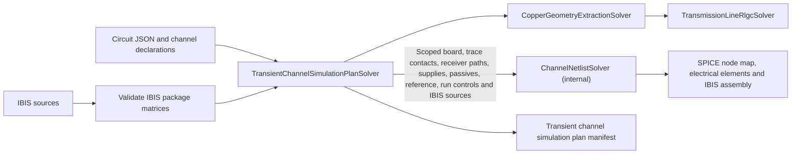
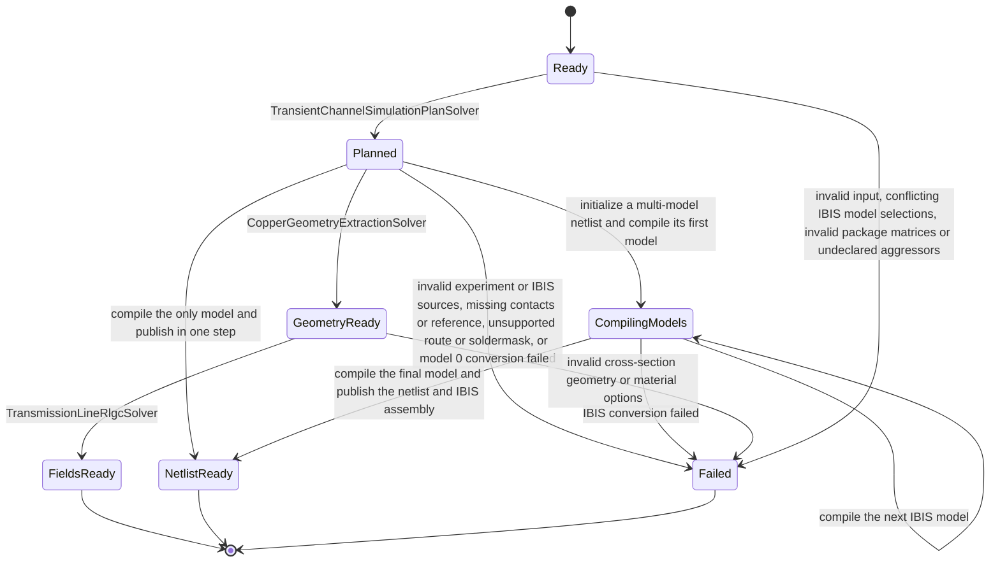
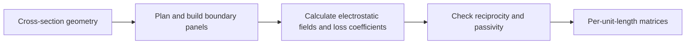
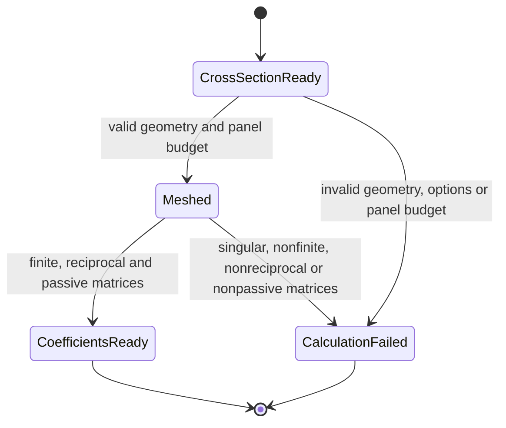

## What is it?

Signal-integrity tools for tscircuit boards.

## How to use it?

The stack retains Circuit JSON validation, physical stackup and stimulus helpers, IBIS asset loading and the ngspice adapter.
`TransientChannelSimulationPlanSolver` reads PCB transient channel simulation records written by core from TSX. It checks
channel endpoints, IBIS models, timing and patterns, including pseudo-random binary sequences (PRBS).
Each declared channel simulation becomes immutable inputs for copper geometry extraction and channel netlist generation.
`CopperGeometryExtractionSolver` models scoped traces, vias, reference pours, and pad contacts. It groups wires into sections with consistent nearby copper and reference surfaces.
`TransmissionLineRlgcSolver` screens nearby wire pairs for coupling and calculates per-unit-length RLGC matrices for each coupled group.
Planning validates selected IBIS package matrices. The internal `ChannelNetlistSolver` allocates SPICE nodes and compiles one IBIS model per step, including scalar or coupled package elements.

Aggressors are output-capable pins retained by the copper scope that do not
drive a declared channel in the simulation. This includes bidirectional
receivers. Declare their state on the simulation. Use `aggressorPattern="0"`
or `"1"` for a quiet level, or use a channel pattern such as `"clock"` or
`"prbs7"` to switch at the simulation bit rate from time zero.
`aggressorDisabled` takes precedence and requires every aggressor
model to support high impedance. The selected channels keep their own
`pattern` and `driverDisabled` settings. The pinned core version emits the
aggressor fields.

Automatic duration covers a full pattern for every switching channel or
aggressor, measured at its declared bit rate after its offset.

## General workflow

### 2D RLGC calculation

The 2D resistance, inductance, conductance and capacitance (RLGC) calculation takes rectangular conductors, reference planes and dielectric layers.
It returns per-unit-length capacitance, inductance, DC resistance, and coefficients for dielectric and skin loss.

## Development validation

Install dependencies with `bun install --frozen-lockfile`, then run `bun test`.
Optional checks use `test.skipIf` and known failures still execute through `test.failing`.
Run `bun run fetch:vendor-models` and put `ngspice` on PATH before running the IBIS tests locally.

Run `bun run test:package` to verify the packed package in Node.
