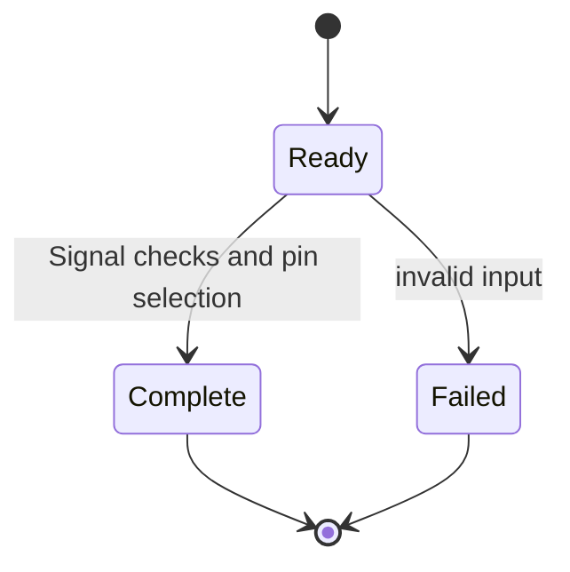

## What is it?

Signal-integrity tools for tscircuit boards.

## How to use it?

The stack retains Circuit JSON validation, physical stackup and stimulus helpers, IBIS asset loading and the ngspice adapter.
Internal preparation checks the endpoint pins, IBIS models, timing and patterns of the PCB transient channel
simulation records that core writes from TSX. Patterns include pseudo-random binary sequences (PRBS).

## General workflow

## Development validation

Install dependencies with `bun install --frozen-lockfile`, then run `bun test`.
Optional checks use `test.skipIf` and known failures still execute through `test.failing`.
Run `bun run test:package` to verify the packed package in Node.
