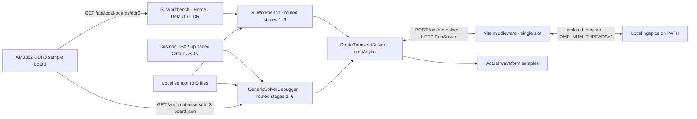
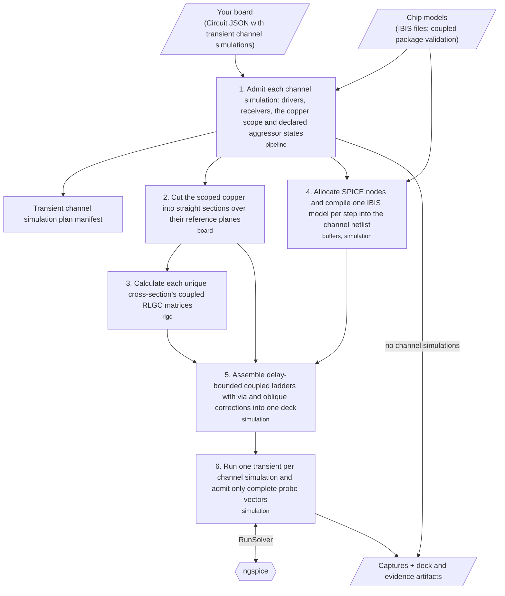
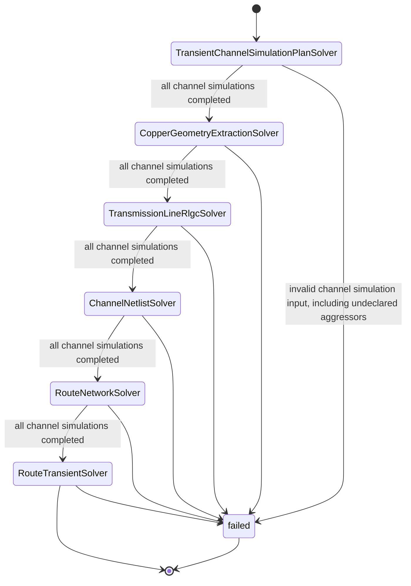
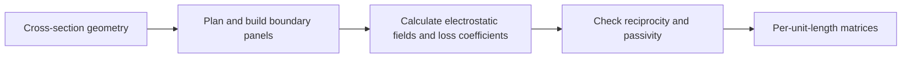
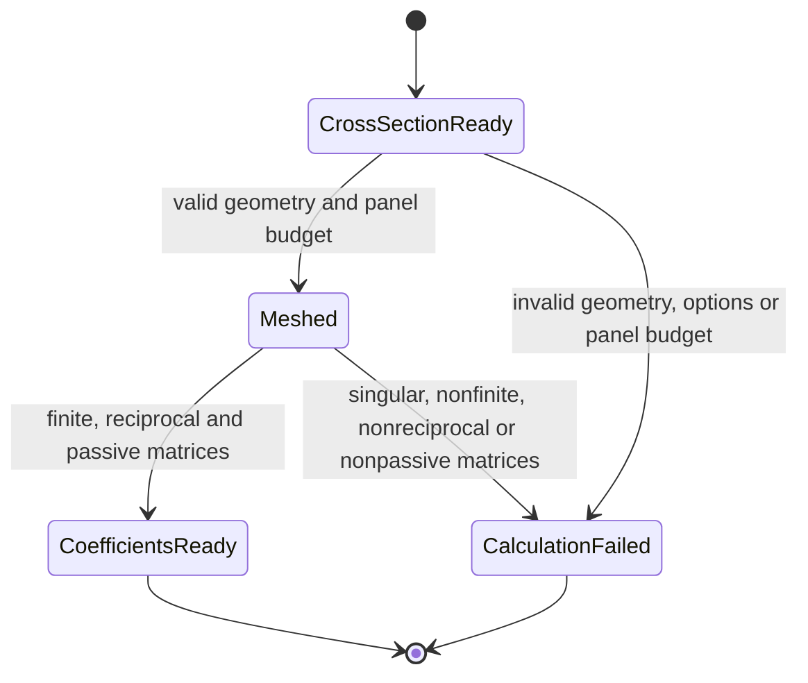

## What is it?

Native signal-integrity simulation for tscircuit boards. Describe each test with
`<simulation.pcbtransientchannelsimulation>` and `<simulation.pcbdriverreceiverchannel>`. `RoutedPipelineSolver` consumes the
resulting Circuit JSON, solves quasi-TEM 2D cross-sections along the actual routed copper (2.5D), assembles
coupled ladders with the IBIS buffers, and runs one transient per channel simulation in ngspice.
This draft implements the pipeline entry of [RFC #28](https://github.com/tscircuit/rfc/pull/28).

## How to use it?

```tsx
import { simulation } from "@tscircuit/core"

<board fabricatorPreset="jlcpcb_standard">
  {/* Place the routed endpoints and their simulation.ibismodel declarations here. */}
  <simulation.pcbtransientchannelsimulation name="DATA_TEST" bitRate="20Mbps">
    <simulation.pcbdriverreceiverchannel name="DATA" driverRef=".TX > .Y" receiverRef=".RX > .A" />
  </simulation.pcbtransientchannelsimulation>
  <simulation.eyediagram name="DATA_EYE" simulationRef="DATA_TEST" />
</board>
```

```ts
import { RoutedPipelineSolver } from '@tscircuit/signal-integrity-pipeline'
import { createNativeSolver, loadIbisSources } from '@tscircuit/signal-integrity-pipeline/node'

const solver = new RoutedPipelineSolver({
  input: { circuitJson, ibisSources: await loadIbisSources({ circuitJson, baseDir: '.' }) },
  context: { runSolver: createNativeSolver(), progress: console.log },
})
await solver.solveAsync()
const { channelSimulations, files } = solver.getOutput()
```

Circuit JSON is the electrical input. `ibisSources` and the `{ runSolver, progress }`
context are IO ports. Circuit JSON durations and channel offsets are in milliseconds.
Captured solver timestamps are in seconds. Each entry in `channelSimulations` holds its compiled ngspice deck,
evidence and completed probe capture.
Captures are candidate evidence without independent convergence qualification.
`files` maps every artifact path to its bytes; writing them is the caller's choice.
A board with no channel simulations completes after planning without invoking a solver.

Branched routes remain unsupported. Inline IBIS coupled package matrices are
validated before the deck is built and lowered to a passive lumped package. Unlisted
pins follow the IBIS [Pin]/[Package] hierarchy and merged rail bus rules;
missing or invalid matrix definitions still fail.
Die POWER/GND references always connect directly to perfect rails;
vendor package R/L/C remains between every mapped pin and its die node.

The TSX examples use the pinned `@tscircuit/core` preview. Place transient
simulations and eye diagrams directly under the board, including when it
contains cached subcircuits. Core checks endpoint connectivity and routing,
supplies preset via plating, and plans omitted pseudo-random binary sequence (PRBS) seeds by channel name.
The pipeline reads the IBIS assets and validates the selected model capabilities.
Aggressors are output-capable pins retained by the copper scope that do not
drive a declared channel in the simulation. This includes bidirectional
receivers. Declare their state on the simulation. Use `aggressorPattern="0"`
or `"1"` for a quiet level, or use a channel pattern such as `"clock"` or
`"prbs7"` to switch at the simulation bit rate from time zero.
`aggressorDisabled` takes precedence and requires every aggressor
model to support high impedance. The selected channels (victims) keep their
own `pattern` and `driverDisabled` settings. TSX authors need a core build that
emits the aggressor fields.

ngspice must already be installed; `createNativeSolver({ tools: { ngspice } })`
accepts an executable path. No package install or solver download happens during
a solve. Native processes are serialized and run with `OMP_NUM_THREADS=1`.
Vendor IBIS files and user-supplied board JSON stay in local, gitignored paths.

### Local fixture site

Run `bun install --frozen-lockfile && bun run dev` with **ngspice on PATH**. Cosmos opens
[http://127.0.0.1:5000](http://127.0.0.1:5000); its Vite fixture renderer and local
API use port 5050. Both bind only to `127.0.0.1`.

The sidebar lists the two-trace TSX board, every signal level, the DDR3 addr/cmd
scope, and a paste/upload Circuit JSON page. Each mounts `GenericSolverDebugger`
with `RoutedPipelineSolver`. Step through channel simulation planning, copper geometry, RLGC fields, the
channel netlist, network assembly and the local ngspice transient. Captures remain candidate
results without independent convergence qualification. The DDR addr/cmd page
runs the full 8 ns transient in about 25 minutes of local ngspice (1,503 s measured),
after about 4 minutes of extraction. Times grow on a busy machine.

Set `IBIS_MODEL_DIR` to the examples' local vendor directory (default `models`).
The DDR3 fixtures and offline examples use `examples/am3352-ddr3/board.circuit.json`
by default. Set `SI_DDR3_BOARD` to an absolute path to use a different export.
The sample is the only full-board Circuit JSON approved for this repository.
Keep vendor IBIS files and other board exports in local, gitignored paths.

The sample came from rendering the Nov 9 source package's `index.tsx` with
`RootCircuit` from `@tscircuit/core@0.0.2468` and `@tscircuit/props@0.0.746`,
using `circuit-json@0.0.561`. Routing was disabled during the render to use the
saved copper. Bun resolved CAD asset imports to package-relative URLs.
The [AM3352 board source](https://github.com/0hmX/am3352-ddr-track-a-local-dfm-wip-20261007)
contains the TSX and the saved routes.

To run the address and command simulation, place `sprm552c.ibs` and
`W631GG6MB-12.ibs` in `models/` or in the directory selected by `IBIS_MODEL_DIR`.



The backend validates JSON bodies, checks same-origin loopback
requests, rejects other solvers and executable/cwd options, and serializes native
runs and version probes. `GET http://127.0.0.1:5050/api/solvers` reports ngspice
availability and version. A missing binary shows `ngspice not found on PATH`.

### SI Workbench

Run `bun run dev` to open **Home** in the **SIWorkbench** group at the top of
the Cosmos sidebar.

- **Home** has a Start Page with **Open Circuit JSON…**, recent files, both
  samples, and the local ngspice status.
- **Default** opens the built-in parallel bus sample.
- **DDR** opens the included AM3352 DDR3 board with address and command
  simulations declared by the fixture.

The Vite server streams the sample board over loopback. The Workbench loads
available vendor IBIS files from the local model directory. With those files
and **ngspice on PATH**, press **F5** to run a local
transient and inspect waveforms and eye diagrams in the Oscilloscope. The
Workbench also supports 2D and 3D copper inspection and edits to stackup,
embedded IBIS models, and stimulus.

External IBIS loading and board-wide design rule checks are future work. The
pipeline rule for receivers that act as aggressors is pending.

## General workflow



The pipeline is inspectable with solver-utils. All six stage rows exist before the
first step. Each stage processes the planned channel simulations in order.

The site's `Step` input starts at 0 for the initial view. Enter 1–6 to inspect a
retained stage. The next pipeline advance selects the active stage. Stages that
have yet to run show a status note. You can step synchronously up to stage 6,
where `RouteTransientSolver` awaits one live ngspice run.

<!-- routed-stages:start -->
| # | Stage solver |
|---|---|
| 1 | TransientChannelSimulationPlanSolver |
| 2 | CopperGeometryExtractionSolver |
| 3 | TransmissionLineRlgcSolver |
| 4 | ChannelNetlistSolver |
| 5 | RouteNetworkSolver |
| 6 | RouteTransientSolver |

```mermaid
flowchart LR
  s0["TransientChannelSimulationPlanSolver<br/>Plan one transient channel simulation per step"]
  s1["CopperGeometryExtractionSolver<br/>All planned channel simulations, one item per step"]
  s2["TransmissionLineRlgcSolver<br/>All planned channel simulations, one item per step"]
  s3["ChannelNetlistSolver<br/>Compile one IBIS model per step"]
  s4["RouteNetworkSolver<br/>All planned channel simulations, one item per step"]
  s5["RouteTransientSolver<br/>All planned channel simulations, one item per step"]
  s0 --> s1
  s1 --> s2
  s2 --> s3
  s3 --> s4
  s4 --> s5
  s5 <-->|"await RunSolver"| engine["local native ngspice"]
```




<!-- routed-stages:end -->

Missing electrical facts fail explicitly. Numerical settings come from selected
IBIS edge rates, bit rates, stackup and actual routes. Every channel simulation produces an
independent run. A differential endpoint drives opposite physical levels and
measures P minus N. Quiet channels remain connected and are probed at the far
receiver and at the near quiet driver. Single-ended probes always use their chip's
local ground. Numeric offsets are seconds. Automatic duration ends when the
last channel or switching aggressor completes one full pattern at its
declared bit rate after its offset.
Clock uses two unit intervals, a switching literal uses its bit count, and
PRBS7 uses 127 unit intervals. Quiet channels use one unit interval from time
zero. A default clock-only or short-literal capture shows the time trace. Set
`duration` for a longer recording or to run PRBS15 or PRBS31. Explicit durations
are used as supplied.
IBIS values always use the typical corner.

### 2D RLGC calculation

The 2D resistance, inductance, conductance and capacitance (RLGC) calculation takes rectangular conductors, reference planes and dielectric layers.
It returns per-unit-length capacitance, inductance, DC resistance, and coefficients for dielectric and skin loss.





## Development validation

Install dependencies with `bun install --frozen-lockfile`, then run `bun test`.
Optional checks use `test.skipIf` and known failures still execute through `test.failing`.
Run `bun run fetch:vendor-models` and put `ngspice` on PATH before running the IBIS tests locally.

Run `bun run test:package` to verify the packed package in Node and Bun.

SVG visual baselines in `tests/**/__snapshots__/` use the `.snap.svg` suffix so GitHub displays image previews.
The visual-test helper compares their contents byte for byte.
