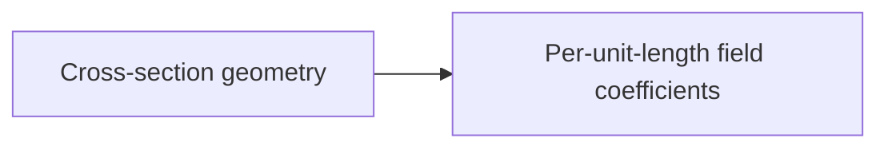
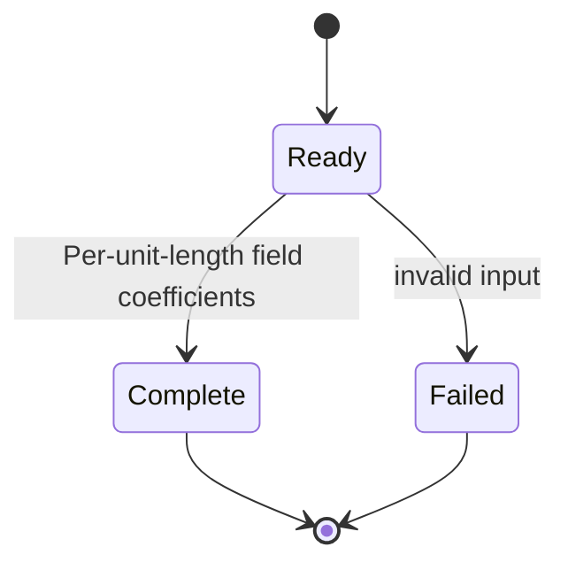

## What is it?

Signal-integrity tools for tscircuit boards.

## How to use it?

The stack retains Circuit JSON validation, physical stackup and stimulus helpers, IBIS asset loading and the ngspice adapter.
`RoutedAdmissionSolver` reads PCB transient channel simulation records written by core from TSX. It checks
channel endpoints, IBIS models, timing and patterns, including pseudo-random binary sequences (PRBS).
Each declared block becomes immutable inputs for route sections and buffer binding.
RouteSectionsSolver divides scoped copper into straight slices and resolves physical endpoint contacts.
The standalone 2D cross-section solve returns per-unit-length C/C0/L and frequency-dependent R/G.

## General workflow

## Development validation

Install dependencies with `bun install --frozen-lockfile`, then run `bun test`.
Optional checks use `test.skipIf` and known failures still execute through `test.failing`.
Run `bun run test:package` to verify the packed package in Node.
