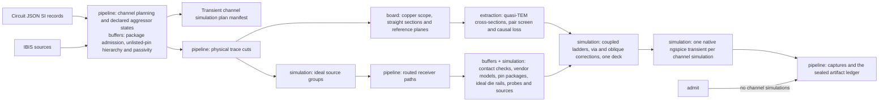
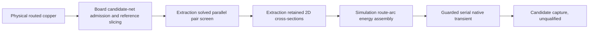
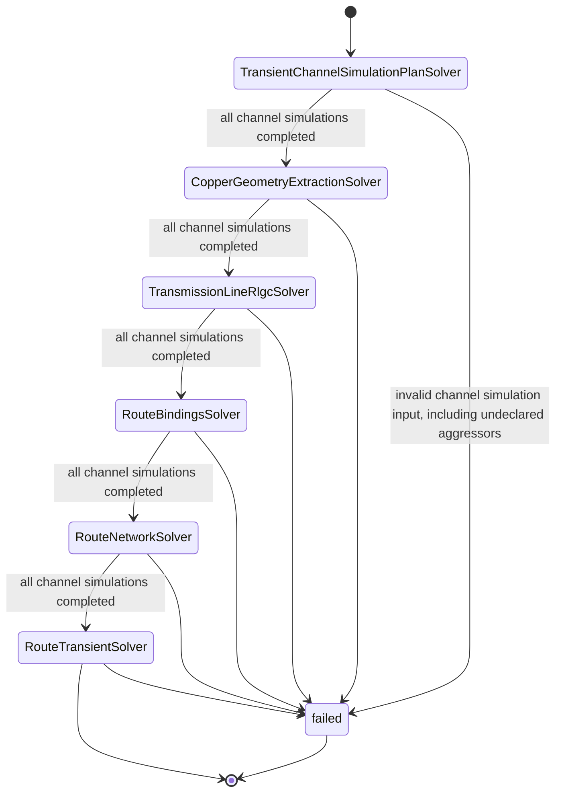
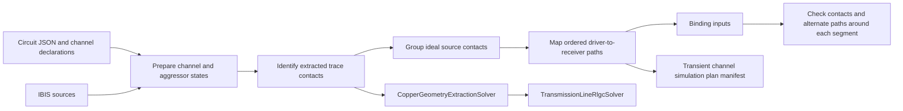
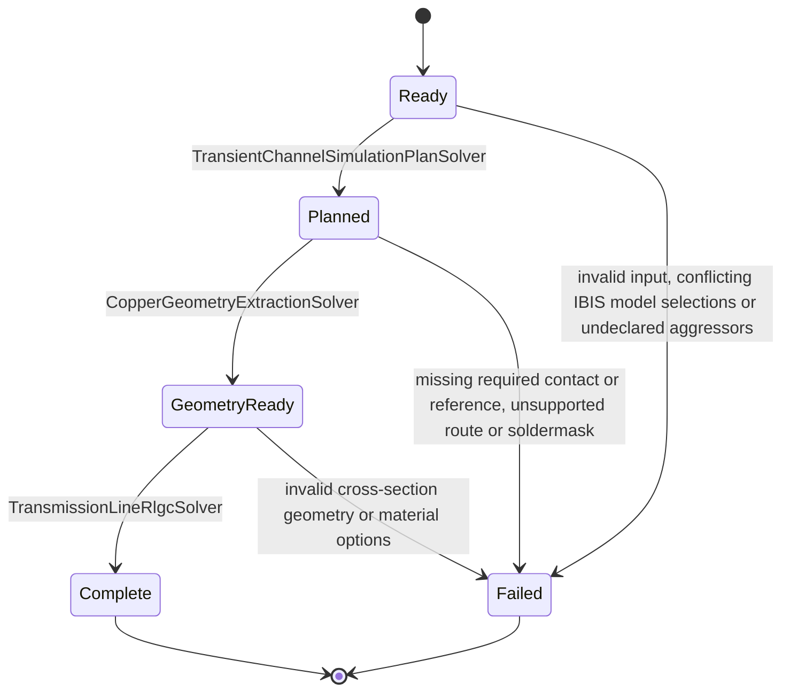
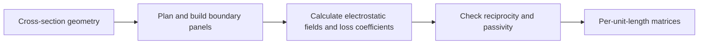
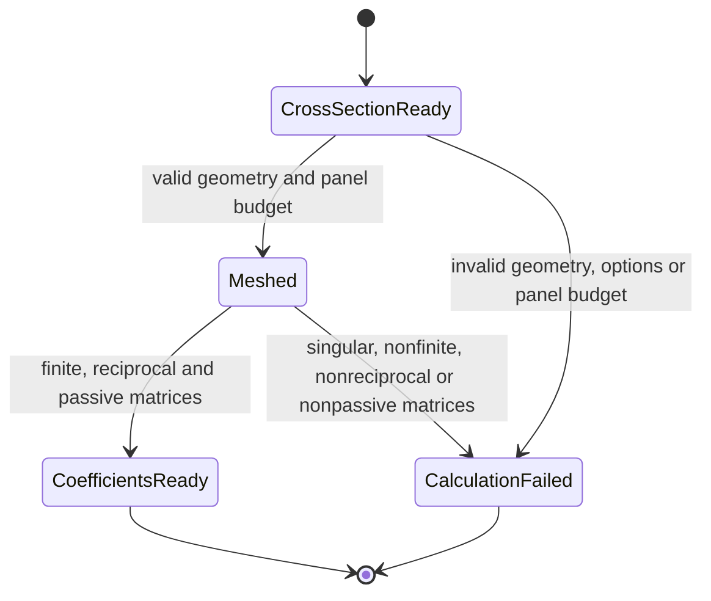

# Signal-integrity pipeline architecture

`RoutedPipelineSolver` is the public entry. It consumes Circuit JSON source records
from RFC #28. `pipeline/signals.ts` (`prepareChannelSimulationById`) groups channel simulations and derives
private settings and native declarations, one channel simulation per planning step. The lowered
transient records are private and never appear in the input Circuit JSON.

The stack retains Circuit JSON validation, physical stackup and stimulus helpers, IBIS asset loading and the ngspice adapter.
Declare transient channels in Circuit JSON. Signal preparation validates endpoint topology, selected IBIS capabilities,
timing and pseudo-random binary sequence (PRBS) patterns.
TransientChannelSimulationPlanSolver lowers each declared channel simulation into immutable inputs for copper geometry extraction and buffer binding.
Ideal wires, named nets and internal pin ties form the source groups used by SPICE.
A named net can span the extracted traces connecting its own contacts, including multipoint ideal junctions.
Channel planning and binding use the same receiver graph. Its paths traverse ideal junctions, extracted traces and series passives.
Rail shunts and differential terminations stay outside those paths, including terminations attached by both copper and ideal wires.
Each extracted trace keeps both physical contacts. Binding checks their selected models and detects signal contacts tied to ground.
Removing an extracted trace or series passive from the receiver graph must disconnect its two ends.
An alternate path reports the physical contacts and distinguishes an entirely routed loop from a bypass through ideal wiring.
`CopperGeometryExtractionSolver` models scoped traces, vias, reference pours, and pad contacts. It groups wires into sections with consistent nearby copper and reference surfaces.
`TransmissionLineRlgcSolver` screens nearby wire pairs for coupling and calculates per-unit-length RLGC matrices for each coupled group.
IBIS conversion resolves scalar or coupled package elements and validates selected package matrices during planning.
RouteBindingsSolver associates compiled buffers, sources and probes with the allocated circuit node map.
RouteNetworkSolver integrates route energies into a coupled ladder with via and oblique corrections and emits a deck.
RouteTransientSolver invokes ngspice through the injected solver port and publishes complete raw-vector captures.

Module boundaries remain enforced by `check:modules`: modules import one another
through their index, never internals; imports are acyclic; only adapters import
Node facilities. Domain modules return owned artifacts. The pipeline ledger
rejects path collisions and seals files in sorted order. Channel simulations have separate
artifact prefixes.

`board` owns physical admission, the copper scope, route sections and board drawings;
`buffers` owns vendor source bytes, pin/model selection and package assembly;
`extraction` owns cross-section field solves, route lines, pair coupling and matrix
checks; `simulation` owns declarations, electrical sources, node identity, the routed
deck and ngspice; `observation` reads native ngspice vectors; `solver` validates
native runs. `adapters` supplies explicit filesystem/process IO.

`buffers/package-model.ts` parses local IBIS package definitions;
`package-matrix.ts` validates the complete matrices and reduces unused floating
pins; `coupled-package.ts` emits the coupled lumped pi circuit. Admission runs
during channel simulation planning, before extraction. Assembly records selected matrices,
original self terms, unused pins, merged rail associations and the termination policy.
Unlisted pins follow the IBIS scalar hierarchy or implicit merged rail bus rules.
Core only checks declaration/model bindings, capabilities and routing. The converter still
supplies die buffers with its package omitted; the pipeline must then realize
the selected vendor package.

Tests use TSX for board reproductions. Synthetic engine responses exercise parsing
and drawing only; they are never claimed as native solver evidence.

The runtime imports the shared circuit-json schemas. Local validation must build the sibling RFC branch until circuit-json#983 is released. No absolute local dependency links are committed. TSX tests and examples use the built core directly.

Core#5286 emits JLC preset plating (0.018 mm), preserving explicit imported stackup plating; routed vias require it. RFC pours request ground escape routing with `unbroken`; the differential example uses manual paths and retains its original autorouter reproduction. Branched routes and cycles remain unsupported.

## RLGC in the routed pipeline

`TransmissionLineRlgcSolver` calls `calculateRlgc` for each unique routed cross-section. The route network consumes the resulting capacitance, inductance and loss coefficients when distributing electrical energy across cells. The routed root publishes its artifacts once all channel simulation stages complete.

## Routed coupling

`board` admits candidate nets within the requested scope radius, which defaults to 32 mm.
`extraction/route-coupling.ts` solves parallel pairs before assembling final
cross-sections; either normalized mutual C or L at least 0.5% retains the pair.
The selected scope and omitted pairs are recorded.

## Inspectable routed compiler

Stage classes live with their domain knowledge. The plan solver calls
`prepareChannelSimulationById` once per channel simulation. Each planned
channel simulation is passed through the same six static top-level stages. The entire
`pipelineDef` exists before planning starts; no step creates stages at runtime.
`RoutedStageSolver` steps each domain algorithm across all planned channel simulations in
order, one domain item per step, and publishes an immutable array in planning
order. It is a `BaseSolver`, with no nested pipeline or child debugger rows.
The single `routedStages` tuple supplies the debugger order, tests, artifact
manifest and generated docs below.
Regenerate with `bun scripts/document-routed-stages.ts`.

<!-- routed-stages:start -->
| # | Stage solver |
|---|---|
| 1 | TransientChannelSimulationPlanSolver |
| 2 | CopperGeometryExtractionSolver |
| 3 | TransmissionLineRlgcSolver |
| 4 | RouteBindingsSolver |
| 5 | RouteNetworkSolver |
| 6 | RouteTransientSolver |

```mermaid
flowchart LR
  s0["TransientChannelSimulationPlanSolver<br/>Plan one transient channel simulation per step"]
  s1["CopperGeometryExtractionSolver<br/>All planned channel simulations, one item per step"]
  s2["TransmissionLineRlgcSolver<br/>All planned channel simulations, one item per step"]
  s3["RouteBindingsSolver<br/>All planned channel simulations, one item per step"]
  s4["RouteNetworkSolver<br/>All planned channel simulations, one item per step"]
  s5["RouteTransientSolver<br/>All planned channel simulations, one item per step"]
  s0 --> s1
  s1 --> s2
  s2 --> s3
  s3 --> s4
  s4 --> s5
  s5 <-->|"await RunSolver"| engine["local native ngspice"]
```

<!-- routed-stages:end -->

`TransmissionLineRlgcSolver` owns its geometry-keyed BEM cache; completed snapshots contain
numeric coefficients without Maps or frequency callbacks. `routedSimulation`,
its bulk `extractRoutes` loop and caller-owned field cache are deleted. Segmentation
and ladder generators retain one canonical algorithm, also drained by existing
numerical primitive callers. Network stepping creates one route run's cells;
its final step assembles the coupled global matrices, oblique/via terms and deck.
One BEM solve is atomic. Route-arc energies store the nonzero entries integrated
from common slices across the R/L/skin/C/dielectric matrices. A non-dominant
shunt can require a dense modal realization.

Coupled series resistance uses a normalized reciprocal multiport. For
`S = diag(sqrt(Rii))`, its auxiliary node voltages are `x = S I`, its
unit-diagonal conductance matrix is `S^-1 R S^-1`, and opposite VCCS stamps
enforce `V = R I`. This congruence preserves signed mutual resistance and
passivity without dense inversion. Uncoupled rows use ordinary resistors.
The former zero-volt sensors and series CCVS chains lost numerical accuracy
at near-zero Foster voltages on large, weakly anchored neighbour networks.
Replacing that realization deliberately changes routed deck bytes and their
pins; field coefficients, loss poles, topology and solver tolerances stay fixed.

Causal skin loss is one coupled layer, not nine. Every Foster pole scales the
same matrix, so `Z(s) = z(s) S`. Rows without mutual terms keep scalar R || L pole
stages. Coupled rows share one normalized multiport: a series VCCS carries
`I = x / sqrt(Sii)`, the auxiliary KCL is `sum_j Sn_ij u_j = V / sqrt(Sii)`, and a
grounded unit Foster stage sequence gives `u = z(s) x`. The former per-pole multiports
and `K` layers stacked nine copies of the coupling graph, which caused 8.9M LU fill
on the DDR3 deck. Those auxiliary rows have no diagonal, so routed decks set
`pivrel=0.1`. `klu_refactor` reuses the pivots chosen on the first transient
iteration, and the default `1e-3` lets the first time point fail. The profiling that
found this is in PR #84.

Completed domain values are copied and frozen. Only the root folds the six stages'
`Produced` artifacts into `ArtifactLedger`; runtime timings stay in `stats`.
Original assumptions, coupling decisions, reference omissions, external ports,
model provenance, node maps, via/oblique policies and deck evidence remain visible.

Every stage draws in board millimetres, y up, inside one fixed camera per problem
(`routeView`): the selected copper and its endpoint parts (a large package only near
the copper), plus a pane slot on the side that brings the camera nearest 1.6:1. Every
stage and every failure shares that camera; failure reasons are written in the pane.
Nets are coloured by electrical connectivity, one hue per net, and a differential
channel's two legs are two shades of one hue. Channels, bit periods and pairs come from
`simulation_pcb_driver_receiver_channel` records. Copper keeps its real width, and its layer is in the stroke: top solid, inner
layers hollow, bottom dimmed. Each stage draws what it produced:

| Stage | Board | Pane |
|---|---|---|
| Transient channel simulation plan | selected nets, drivers as dots, receivers as rings | each net's routed length, to scale |
| Sections | sections in two tones of the net's hue, the route cut this step cased white, uncut copper grey | the same partition unrolled per net |
| Fields | solved copper coloured by Z0, an amber cut at the slice on screen | that slice's stack at one mm scale, Z0 of selected conductors, coupling bands sized by k, the Z0 scale |
| Bindings | bound parts outlined, ▶ at drivers and ◁ at receivers along the trace | each bound net with its buffer glyphs |
| Network | coupling bands between parallel sections (width grows with k), cell ticks, modelled vias | cells and coupling unrolled per net |
| Transient | probe marks | an eye folded every two bit periods when the capture is long, else the window from the first activity; IBIS Vinl–Vinh of single-ended receivers as a band; above six far-end probes an envelope plus the worst curve; amber hatching while ngspice runs |

Only Z0 values, axis ticks, strip names and lengths, and a failure reason are written;
silkscreen text never reaches the picture. Every net, mark and curve carries its net
label, so the site can link them on hover.

`src/board/board-picture.ts` puts the real board under that drawing. `circuit-to-svg`
renders a dimmed top view (soldermask, pads, silkscreen lines) of only the records
near the camera, through a `viewport` equal to it. The overlay is graphics-debug's own
SVG, cropped by `viewBox` to the camera frame it finds in that SVG, so objects outside
the camera never move it. Both layers are letterboxed in the same box. Only scripts and tests import the module, so `circuit-to-svg` stays a development dependency outside the library bundle. Display sampling caps object counts;
numerical inputs and native samples remain complete.

`RouteTransientSolver` awaits one `solver.invoke` call in `_stepAsync`. Its
self-contained `.save` + `.tran` deck keeps KLU and Gear in native batch ngspice.
Native batch emits ASCII raw vectors (`SPICE_ASCIIRAWFILE=1`). Diagnostics, finite
samples, start and final simulated time are checked before publishing a capture.
Errors leave the stage failed without partial output. Native adapter instances
share a process queue and set OMP_NUM_THREADS=1. Large DDR3 transients remain
unverified. Completion is candidate evidence without independent convergence
qualification.

Async stepping uses solver-utils PR #62 at `127f17012c7c391005254993864b26801f418249`
through an integrity-locked pkg.pr.new URL. Switch to a release after #62 ships.

## 2D RLGC calculation

The internal `calculateRlgc` function in `src/rlgc/` calculates the per-unit-length matrices in input conductor order.
Capacitance (with dielectrics and in vacuum) is in F/m, external inductance is in H/m and DC resistance is in Ω/m.
For frequency `f` in Hz, multiply the dielectric loss coefficient (F/m) by `2πf` for conductance in S/m.
Multiply the skin resistance coefficient (Ω/m/√Hz) by `√f` for the high-frequency skin contribution in Ω/m.
The calculation also returns the conductor-only skin coefficient, obtained with fixed reference planes.

Interfaces in a half-space extend by the requested number of cross-section spans. Between two reference planes, padding is measured in the lateral field decay length (plane spacing divided by π). Each shielded region is limited to 3072 boundary panels before dense matrix allocation.

The native adapter waits for the executable to exit. The legacy caller-specified timeout and its dedicated diagnostic were removed. IBIS source validation continues to check paths and reject non-IBIS data. The previous byte-size limit was removed.
