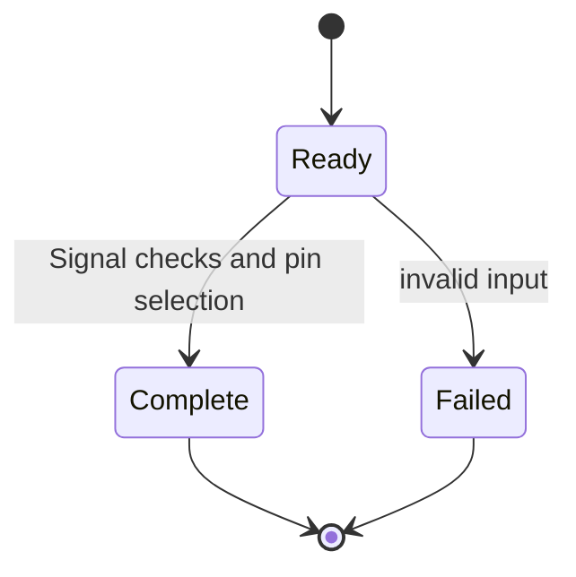

# Signal-integrity pipeline architecture

The stack retains Circuit JSON validation, physical stackup and stimulus helpers, IBIS asset loading and the ngspice adapter.
Declare transient channels in Circuit JSON. Signal preparation validates endpoint topology, selected IBIS capabilities,
timing and pseudo-random binary sequence (PRBS) patterns.

