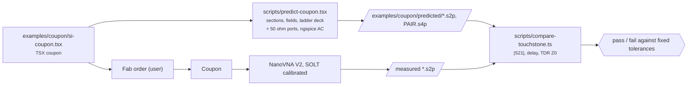

# Hardware validation: SI coupon and NanoVNA

Nothing here has been measured yet. The coupon is designed, its S-parameters are predicted, and the compare tool
is tested on synthetic data. This page is the plan for the day a board and a NanoVNA exist. Ordering the board and
the instrument is the user's decision; nothing has been bought or uploaded to a fab.



## The coupon

`examples/coupon/si-coupon.tsx` is a 4-layer, 1.6 mm board of 100 × 84 mm with a stepped outline, so every
edge-launch SMA sits on a board edge while each line keeps its own length. L2 and L3 are solid GND pours. Every
line is a top microstrip over L2, except the bottom section of VIA, which runs over L3.

| Structure | Ports (Touchstone order) | Edge-to-edge | What it is for |
|---|---|---|---|
| FIX2X | J1, J2 | 20 mm | 2× thru: two 10 mm launch halves back to back; divide it out of the other S21s |
| THRU50 | J3, J4 | 50 mm | 50 Ω microstrip, 0.152 mm wide |
| STEP | J5, J6 | 50 mm | 10 mm at 50 Ω, 30 mm at 0.5 mm wide (≈ 25 Ω), 10 mm at 50 Ω |
| VIA | J7, J8 | 50 mm | top 19 mm, via to bottom, 10 mm, via back to top; a GND stitching via 1 mm either side of each signal via |
| THRU100 | J9, J10 | 100 mm | THRU50 at 100 mm, for a length-difference delay per mm that cancels both connectors |
| PAIR | J11, J12, J13, J14 | 100 mm | edge-coupled pair, 0.2 mm gap over 78.4 mm with 45° fan-outs; NEXT = S31, FEXT = S41 |

### Stackup: JLC04161H-3313

`fabricatorPreset="jlcpcb_standard"` on a 4-layer 1.6 mm board resolves JLC's default build, JLC04161H-3313, in
`@tscircuit/core`. JLC publishes it on its [impedance page](https://jlcpcb.com/impedance) (read 2026-11-15):

| Layer | Material | Thickness | Dk (JLC) | Dk (core preset) |
|---|---|---|---|---|
| L1 top | copper, 1 oz | 0.035 mm | — | — |
| prepreg | 3313 × 1 | 0.0994 mm | 4.1 | 4.1 |
| L2 GND | copper, 0.5 oz | 0.0152 mm | — | — |
| core | NP-155F | 1.265 mm | 4.6 | 4.42 |
| L3 GND | copper, 0.5 oz | 0.0152 mm | — | — |
| prepreg | 3313 × 1 | 0.0994 mm | 4.1 | 4.1 |
| L4 bottom | copper, 1 oz | 0.035 mm | — | — |

The microstrips see only the 3313 prepreg, where the two sources agree; L2 and L3 shield the core, so the core Dk
difference (4.6 against 4.42) does not reach these lines. JLC04161H-7628 (7628 prepreg 0.2104 mm, Dk 4.4) was the
alternative. It would widen the 50 Ω line to about 0.34 mm, a better match to SMA pins. But tscircuit cannot select
it from TSX: the preset picks the first 4-layer 1.6 mm entry. The model's material assumptions, which are not
measured data, are: soldermask 20 µm with Dk 3.3 and tan δ 0.025, laminate tan δ 0.02, and smooth copper.

### Launch

The edge-launch SMA footprint is generic. It has a 0.4 × 1.5 mm signal pad and 3 × 1.2 mm GND pads on top and
bottom at ±2.4 mm, each with two vias to L2/L3. Pads sit 0.25 mm back from the edge to keep JLC's 0.2 mm
copper-to-edge clearance. **Check the footprint against the datasheet of the connector you actually buy before
ordering.** SMA is used rather than u.FL for three reasons: the NanoVNA has SMA ports; edge-launch SMA needs no
adapter cable; and u.FL is rated for about 30 mating cycles. The pipeline models the signal pad as a parallel-plate
capacitor but not the connector body. Compare raw files only together with FIX2X.

## Predictions

`tsx scripts/predict-coupon.tsx` runs each structure through the routed pipeline's own stages:
`RouteSectionsSolver`, `RouteFieldsSolver` and `RouteNetworkSolver` (with copper, cross-sections, the coupled
ladder, oblique corrections and the via and pad transitions). It then replaces the transient control lines with 50 Ω ports
and runs a 201-point linear ngspice AC sweep from 50 kHz to 3 GHz, one run per driven port:
S_jk = 2 V_j / V_source − δ_jk. No IBIS buffers take part. The whole run takes about 15 s. The committed files are
in `examples/coupon/predicted/` (188 KB). `SI_NATIVE_TESTS=1` regenerates them and fails if they are stale.

| Structure | Fitted delay (0–2 GHz) | TDR Z0, middle of structure | \|S21\| 1 GHz | \|S21\| 2 GHz | \|S21\| 3 GHz |
|---|---|---|---|---|---|
| FIX2X | 121.5 ps | 48.0 Ω | −0.14 dB | −0.22 dB | −0.37 dB |
| THRU50 | 304.7 ps | 50.5 Ω | −0.35 dB | −0.63 dB | −0.92 dB |
| STEP | 296.2 ps | 28.5 Ω (wide section) | −1.89 dB | −1.19 dB | −0.89 dB |
| VIA | 366.6 ps | 53.1 Ω | −0.40 dB | −0.60 dB | −1.00 dB |
| THRU100 | 610.0 ps | 51.2 Ω | −0.72 dB | −1.18 dB | −1.66 dB |

PAIR: thru |S21| is −0.77 dB at 1 GHz and −2.04 dB at 3 GHz. NEXT (S31) is −20.4 / −41.3 / −36.6 / −27.5 dB at
0.5 / 1 / 2 / 3 GHz. FEXT (S41) is −28.7 / −23.4 / −18.0 / −15.3 dB.

The TDR uses NanoVNA-Saver's low-pass method (`src/NanoVNASaver/Windows/TDR.py`, `updateTDR` and `_tdr_lowpass`
at commit 3445a0a). The first sample stands in for DC. The spectrum is mirrored to a real impulse and tapered by a
Kaiser window (β = 6, its "Normal" choice). The inverse DFT is summed to a step, and Z = 50 (1 + ρ)/(1 − ρ). Use the
same window in NanoVNA-Saver when you read the measured TDR by eye.

### Prediction checks (fixed before the predictions existed)

The checks are in `tests/tooling/predict-coupon.test.tsx`. Each reference is the pipeline's own field solve of the
same microstrip: Z0 = 49.98 Ω and √(LC) = 6.101 ps/mm at 0.152 mm, and 24.82 Ω at 0.5 mm.

| Check | Tolerance | Measured | Status |
|---|---|---|---|
| Reciprocity \|Sij − Sji\| and passivity Σ\|S\|² per column, every structure | 1e-6 | holds | pass |
| THRU50 / THRU100 delay = routed length (48 / 98 mm) × √(LC) | 1 % | +4.05 % / +2.03 % | todo (finding) |
| THRU50 / THRU100 TDR Z0 = √(L/C) | 2 % | +1.04 % / +2.44 % | todo (finding) |
| STEP TDR plateau = wide-section √(L/C) | 10 % | 28.48 Ω vs 24.82 Ω, +14.8 % | todo (finding) |
| Committed files equal a fresh ngspice run (native) | 1e-6 | equal | pass |

The table below gives post-hoc readings of the failures. These are explanations found after the checks failed, not re-fitted checks.

| Finding | Reading |
|---|---|
| Delay excess | Both thrus carry the same +11.6 ps, the two SMA signal pads that the pipeline models as parallel-plate C (0.22 pF each). THRU100 − THRU50 gives 6.106 ps/mm against √(LC) = 6.101 ps/mm (+0.09 %). The expected value left out the pads. |
| THRU100 Z0 | A lossy line's TDR ramps up with distance, and the middle of 98 mm sits higher than the middle of 48 mm. |
| STEP plateau | A 377 ps round trip is too short for a 3 GHz window to settle. In the frequency domain, \|S21\| at 1 GHz (−1.89 dB) matches the −1.94 dB quarter-wave dip of a 25 Ω section. |
| Via pair | VIA is 61.9 ps slower than THRU50 after the pads, about 31 ps per via. A 1.6 mm barrel has about 10 ps of physical length, so the lumped via and return model may be pessimistic. This is the first thing the measurement should settle. |

## Compare tool

```sh
# Raw thru: |S21|, delay and TDR Z0 against the prediction.
tsx scripts/compare-touchstone.ts --measured thru50.s2p --predicted examples/coupon/predicted/THRU50.s2p
# De-embedded: both S21s divided by their own 2x thru (removes connectors from delay and loss).
tsx scripts/compare-touchstone.ts --measured thru50.s2p --predicted examples/coupon/predicted/THRU50.s2p \
  --fixture-measured fix2x.s2p --fixture-predicted examples/coupon/predicted/FIX2X.s2p
# PAIR with a 2-port VNA: measured port 1 on J11, port 2 on J13 (NEXT), J12 and J14 terminated in 50 ohm.
tsx scripts/compare-touchstone.ts --measured next.s2p --predicted examples/coupon/predicted/PAIR.s4p --ports 1,3
```

The tool reports the following:
- |S21| in dB and the phase error against frequency;
- the least-squares S21 delay (−dφ/dω over 0–2 GHz);
- the TDR Z0, taken as the median Z over 0.3–0.7 of the structure's round trip, with both the measured and the
  predicted value shown;
- the RMS and maximum TDR profile error. Before comparing, the measured profile is shifted by its extra connector delay.

The exit code is 1 when a check fails. Delay and Z0 apply only to thru paths. NEXT and FEXT report |S21| only.

| Check | Tolerance | Why |
|---|---|---|
| TDR Z0 | 5 % of predicted | JLC controls impedance to ±10 %, so the measured Z0 is always printed. 5 % separates "model right, fab off" from "model wrong". |
| Delay | 3 % | 3 % delay is 6 % effective Dk, about the spread between the published Dk and FR-4 at 1–3 GHz |
| \|S21\| | 1 dB up to 2 GHz | This bounds loss-tangent and roughness error (roughness is not modelled), well above the NanoVNA V2's few-tenths-dB S21 uncertainty. |

The tests in `tests/tooling/compare-touchstone.test.ts` make a synthetic "measured" file from the committed THRU50
prediction. They check that the tool:
- catches a 10 % Z0 error (Z → 1.1 Z at unchanged propagation) as a Z0 failure, while +4 % passes;
- catches a 5 % delay error and a 1.5 dB loss error;
- passes the prediction compared with itself with zero error;
- recovers an analytic line's Z0 within 1 % and its delay within 0.5 %.

**What a pass means:** the as-built line matches the model's impedance, delay and loss within the tolerances above,
on this stackup and up to 2–3 GHz. A pass does not validate the DDR3 board, the IBIS buffers or anything above
3 GHz. A failure is a finding to report with its numbers. Never widen a tolerance to make a board pass.

## Bill of materials (approximate, check prices at order time)

| Item | Qty | Approx. cost (USD) |
|---|---|---|
| Coupon PCB, JLC 4-layer 1.6 mm JLC04161H-3313, impedance control, 5 pcs | 1 order | 15–40 plus shipping |
| Edge-launch SMA jack for 1.6 mm boards | 14 per board | 1–4 each |
| NanoVNA V2 (S-A-A-2 / V2 Plus4 class, 50 kHz–3 GHz or more) | 1 | 70–150 (V2 Plus4 Pro more) |
| SOLT cal kit (SMA short, open, 50 Ω load; often included) | 1 | 0–30 |
| SMA–SMA cables, phase-stable, ≤ 30 cm | 2 | 10–30 |
| SMA 50 Ω terminations, for PAIR's unused ports | 2 | 3–10 each |
| SMA torque wrench, 8 in-lb (0.9 N·m) | 1 | 15–40 |

Get the NanoVNA V2 / V2 Plus4 class (S-A-A-2 lineage) rather than the original NanoVNA-H. It reaches 3 GHz with
usable dynamic range, and its linear sweeps import straight into NanoVNA-Saver.

## Fab-order checklist (the user places the order)

1. Render the TSX and export Gerbers with tscircuit. Check the board is 4 layers, 1.6 mm, and has the stepped outline.
2. Select stackup **JLC04161H-3313** explicitly and turn on **impedance control**. State 50 Ω single-ended on L1/L4
   for a 0.152 mm trace referenced to L2/L3. Accept JLC's suggested width only if it is within 0.01 mm, and if it
   changes, update `couponLineWidthMm` and rerun the predictions.
3. Use 1 oz outer and 0.5 oz inner copper. Use green soldermask, and record the mask JLC actually uses. ENIG
   finish is preferred for repeatable SMA pads.
4. Leave out the junction pads JS1 and JS2: they are copper under the STEP traces, not parts.
5. Check the SMA footprint against the bought connector's datasheet.
6. Do not order PCBA: hand-solder the SMAs, so the launch is the only assembly variable.

## Measurement procedure

1. Warm the NanoVNA up for 15 minutes. Set a linear sweep from 50 kHz to 3 GHz with 201 points, matching the
   prediction (NanoVNA-Saver: start 50 kHz, stop 3 GHz, segments × points = 201), and averaging ≥ 4.
2. Do a **SOLT** calibration at the cable ends: short, open, load on port 1, and isolation with both ports loaded.
   Then do the thru with the two cables joined by an SMA–SMA barrel. If the kit gives them, enter its
   offset delays and standard definitions. Torque every SMA to 8 in-lb.
3. Measure each 2-port structure with port 1 on the first-listed connector. Measure PAIR as three 2-port shots:
   J11→J12 (thru), J11→J13 (NEXT) and J11→J14 (FEXT), with the two unused ports terminated in 50 Ω.
4. Export **Touchstone 2-port** (`File → Save 2-Port file (S2P)` in NanoVNA-Saver). The V2 measures S11 and S21
   only. The compare tool reads only those two, so the zero S12/S22 columns are fine.
5. Run the compare tool, raw and with the FIX2X fixture pair, and record the numbers with the board serial.
6. For a delay check independent of both connectors, also compare the THRU100 − THRU50 delay difference
   (prediction: 305.3 ps for 50 mm, 6.106 ps/mm).

## Alternative: scope probing on the AM3352 board

A scope check needs no coupon, but it is much weaker evidence:

- **Scope:** ≥ 1 GHz bandwidth. A DDR3-800 edge is about 300–500 ps (10–90 %), so 0.35 / 0.4 ns needs at least
  1 GHz, and 2–4 GHz is better. Sample at ≥ 5 GS/s.
- **Probe:** an active probe (≥ 1.5 GHz, < 1 pF), or a solder-in 450 Ω + 50 Ω coax probe at the scope's 50 Ω
  input (about 10:1). Use a ground spring of a few mm, never the 15 cm ground lead.
- **Net:** one DDR3 address/command line in `DDR3_ADDR_CMD`, for example DDR_A0. Probe at the memory's ball or
  its nearest via on the board's bottom side, with GND at an adjacent ground via. This is the receiver node the
  pipeline probes. Trigger on DDR_CK.
- **What to compare:** the receiver waveform against the `DDR3_ADDR_CMD` capture
  (`scripts/run-routed-ddr3.tsx`): 50 % crossing delay from the controller edge, overshoot and undershoot in mV,
  ringing settle time, and the eye height at the receiver's threshold. The probe load and the unknown vendor
  silicon corner (IBIS typ only) limit the agreement to roughly 10–20 %. Use this as a sanity check, not as a
  validation of the field solver.
- Keep any board captures in `.cache/`. Aggregates (mV, ps, %) may go in docs; waveforms and geometry may not.
