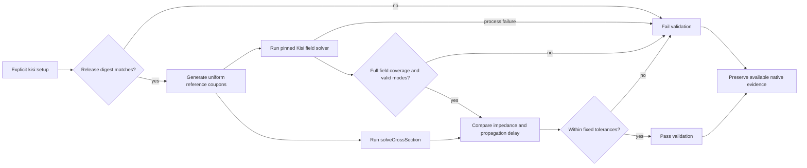

# Kisi development validation

Compare `solveCrossSection` with [Kisi 0.3.3](https://github.com/riehlies/kisi/releases/tag/v0.3.3)'s independent Forstén field solver. Kisi is GPL-3.0-only and runs as an external development tool, obtained from its upstream release and checked against its SHA-256. It is not bundled with the library.

## Fixed comparison protocol

Use three uniform, vendor-free microstrip coupons: single-ended width/height ratios 0.5 and 1, and a symmetric differential pair with width/height 1 and edge-gap/height 0.5. All have a 1 mm substrate, εr 4, 35 µm copper, no soldermask, an uninterrupted ground plane, and 20 mm of straight trace. There are no pads, vias, stubs, devices, or automatic routes. The field solver's infinite-plane cross-section and the centre of each KiCad coupon represent the same geometry.

The maximum relative difference is **3% in characteristic impedance** and **2% in propagation delay**. These engineering comparison thresholds allow for the two independent field discretizations and finite interface extents; they are not statements of physical accuracy. They are fixed before comparing the pipeline with these fixtures. Do not widen them to accommodate a failed result.

Compare the single-ended mode for each isolated trace and the odd/differential mode for the pair. Also compare the pair's even/common propagation delay. Differential impedance is twice the odd-mode impedance. Delay is per-unit-length √(LC) times the 20 mm coupon length; it is not loaded step delay or eye alignment.

A live result must come from the pinned CLI, cover 100% of the target length with its field solver, contain one uniform section of the expected length, and contain finite positive numerical results. A missing CLI, timeout, nonzero process exit, malformed result, or formula fallback is a validation failure. The ordinary offline suite explicitly skips the live check unless requested.

## Scope

This checks the quasi-TEM cross-section fields. It does not qualify route admission, PCB connectivity/short detection, losses, SPICE export fitting, IBIS, or eye measurements. The earlier [three-board experiment](https://github.com/ShiboSoftwareDev/kisi-signal-integrity-benchmark) records separate timing/export disagreements and an invalid shorted board; its eye results are not treated as golden physical references.

The existing analytical known-answer checks remain useful alongside this independent numerical comparison. Kisi's own models are approximations, so disagreement requires investigation rather than assuming either tool is correct.

## Run locally and in CI

```sh
bun install --frozen-lockfile
bun run kisi:setup
bun run test:kisi
```

`kisi:setup` downloads the official standalone Node CLI into ignored `.cache/kisi/` and verifies [the pinned release hash](../tests/fixtures/kisi/release.json). It verifies an existing cached copy too. There is no automatic network access during ordinary tests. A corrupt cached CLI fails with cleanup instructions; the dedicated validation command also fails if setup has not been run.

`test:kisi` explicitly enables `SI_KISI_TESTS=1`, uses `bun:test` sequentially, and prints both tools' numbers, percentage differences, and durations. The workflow runs the same Bun test commands after a frozen Bun install. Node 24 runs the unmodified Kisi CLI and the package-consumer checks. The full native JSON, generated KiCad coupons, configurations, and invocation records are kept in `.cache/kisi-validation/` and uploaded as CI evidence, including on assertion failures. Each coupon output directory is replaced for its next run; failed runs cannot reuse stale reports. The field cache is separate and keyed by the release digest. `KISI_THREADS=1` is a supported upstream runtime setting; the release is unmodified.



## Initial live result

Measured 18 November 2026 with the protocol committed before the first comparison. No threshold was adjusted after seeing these numbers.

| Coupon and quantity | Pipeline | Kisi | Relative difference |
| --- | ---: | ---: | ---: |
| Narrow microstrip impedance (Ω) | 96.567 | 96.017 | 0.572% |
| Narrow microstrip delay (ps) | 110.439 | 110.888 | 0.404% |
| Wide microstrip impedance (Ω) | 72.690 | 72.323 | 0.508% |
| Wide microstrip delay (ps) | 112.868 | 113.320 | 0.399% |
| Differential impedance (Ω) | 106.419 | 105.019 | 1.333% |
| Differential/odd delay (ps) | 106.071 | 106.147 | 0.072% |
| Common/even delay (ps) | 117.011 | 117.346 | 0.286% |

Fixtures live in `tests/support/kisi-fixtures.ts`; the comparison assertions live in `tests/support/kisi.test.ts`, alongside the repo's other integration fixtures. The KiCad serializer describes these exact straight coupons only. It is not used to export or validate routed boards. No production sources, public exports, or library dependencies change.
